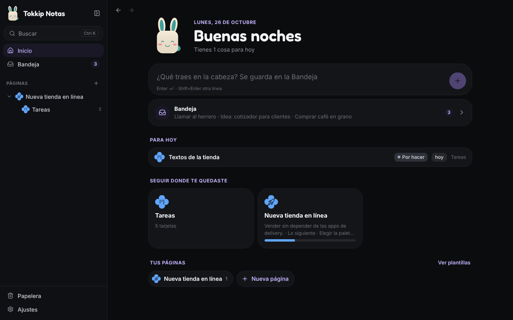
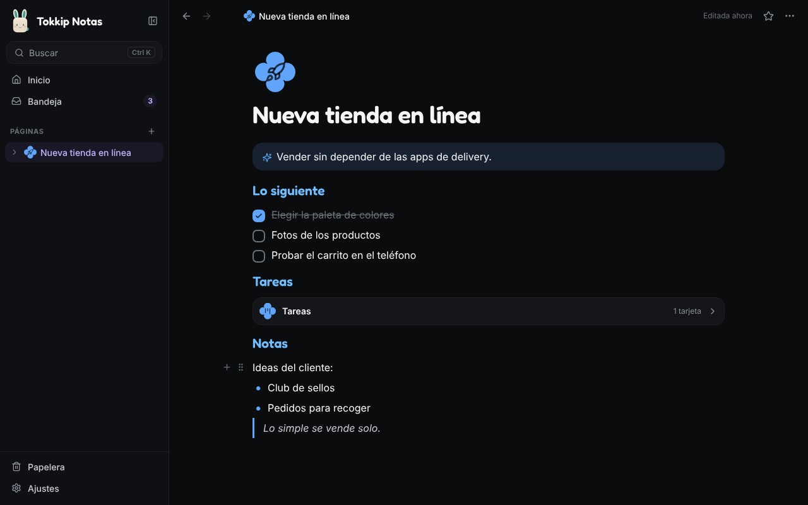
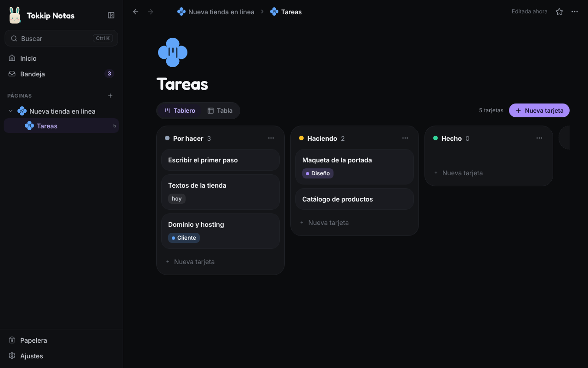

# Tokkip Notas para Windows

Tu cuaderno estilo Notion, con el diseño de Tokkip y sin lo tedioso: la
versión de PC de Tokkip Notas (la de Android vive en `android/notas`). Las
mismas páginas, tableros, tablas y plantillas, pensadas para teclado y mouse.



## Qué trae

- **Inicio**: Tokkip te saluda, un campo para sacar lo que traes en la cabeza
  (llega a la **Bandeja**), lo que tienes para hoy en tus tableros, lo último
  que abriste, tus favoritos y tus páginas.
- **El árbol a la izquierda**: arrastra una página sobre otra para meterla
  dentro, o entre dos para reacomodarla. Clic derecho para más opciones.
- **Escribir por líneas**: «/» abre el menú de lo que puede ser cada línea
  (título, subtítulo, viñetas, lista numerada, pasos, cita, aviso con Tokkip,
  separador) y para meter una subpágina, un tablero o una tabla; escribe para
  filtrarlo. También funcionan «# », «## », «- », «1. », «[] », «> », «! » y
  «---». Arrastra una línea por su asa para moverla. `Ctrl+Enter` marca un paso.
- **Tableros y tablas**: arrastra tarjetas entre columnas, agrega columnas al
  tablero, y en la tabla edita cada celda ahí mismo (texto, número, estado,
  etiquetas, fecha, casilla), agrega o cambia columnas y ordena por cualquiera.
  Cada tarjeta se abre como página con sus datos arriba.
- **Plantillas**: las ocho de Android (proyecto con su tablero, apuntes de
  clase, reunión, lista de lecturas y pelis, viaje…).
- Ícono, color y forma de Material Expressive por página, favoritos, búsqueda
  sin acentos (`Ctrl+K`), mover a otra página, copiar como texto y Papelera de
  30 días.
- Tema claro, oscuro o como Windows; los sonidos de Tokkip; su especie y color.




## Atajos

| Atajo | Qué hace |
|---|---|
| `Ctrl+K` | Buscar |
| `Ctrl+N` | Página nueva |
| `Ctrl+\` | Mostrar u ocultar el panel |
| `Alt+←` / `Alt+→` | Atrás / adelante (también los botones laterales del mouse) |
| `/` | El menú de la línea |
| `Ctrl+Enter` | Marcar o desmarcar un paso |

## Tus notas

Todo vive en tu PC, sin cuentas: una base de datos SQLite
(`notas.db`, la misma tabla que en Android) en
`%APPDATA%\mx.loperstack.tokkipnotas`. Solo los títulos están en memoria; el
texto de una página se lee al abrirla. Cada día, al abrir la app, se guarda una
copia en `backups\` (se quedan las últimas 7).

**Sincronizar con el teléfono y la tablet**: sube `notas-sync/sync.php` a tu
hosting ([cómo](../notas-sync/README.md)) y en Ajustes → Sincronizar pon su
dirección, la clave y tu frase secreta. Se sincroniza al abrir, unos segundos
después de cada cambio, cada pocos minutos y al volver a la ventana. Las notas
viajan cifradas con tu frase; la clave y la frase se guardan en el
Administrador de credenciales de Windows.

**Copias**: en Ajustes → Tus notas, «Guardar una copia» hace un archivo
`.json`; ábrelo en otro aparato con «Abrir una copia» (Juntar o Reemplazar).
Es el mismo formato en Android y en Windows.

## Compilar

```bash
cd notas-pc
npm install
npm run dev          # la interfaz en el navegador (las notas se guardan en el navegador)
npm run tauri dev    # la app de verdad
npm test             # pruebas del modelo
npx tauri build      # el instalador en src-tauri/target/release/bundle/nsis/
```

Tauri 2 (Rust) con Preact y TypeScript. Tokkip se dibuja en código
(`src/tokkip/art.ts`, el mismo dibujo que en Tokkip PC y Healthy PC). Los
sonidos son los de Tokkip y la fuente Fredoka va bajo la SIL Open Font License.
